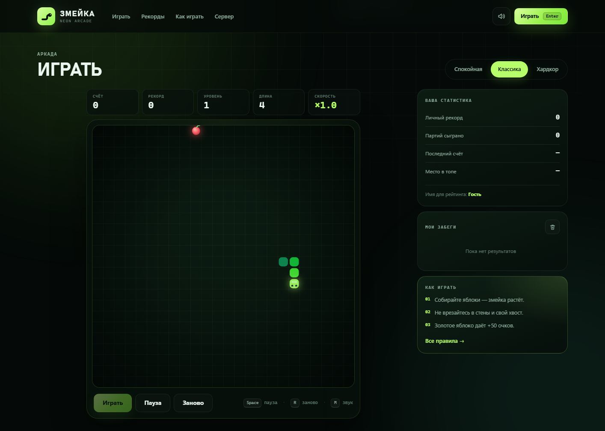

# ЗМЕЙКА — браузерная аркада с сервером рекордов

[](https://github.com/ArchiMYid2023/zmeyka/actions/workflows/ci.yml)
[](https://render.com/deploy?repo=https://github.com/ArchiMYid2023/zmeyka)

Полноценный сайт: неоновая «Змейка» на canvas, Node.js-сервер, общий зал славы и хранение результатов в JSON. Без внешних библиотек и сборки.

**Репозиторий:** [github.com/ArchiMYid2023/zmeyka](https://github.com/ArchiMYid2023/zmeyka) · лицензия MIT.



## Быстрый старт

Нужен Node.js 18+.

1. **Windows:** двойной клик по `start.cmd` — сервер запустится в отдельном окне, браузер откроется сам.
2. **Вручную:**
   ```bash
   npm start
   # или
   node server.js
   ```
   Откройте http://127.0.0.1:5178

Порт и хост можно изменить: `PORT=8080 HOST=0.0.0.0 node server.js` (в PowerShell: `$env:PORT=8080; node server.js`).

## Что умеет игра

- Три сложности: **Спокойная** (стены пропускают), **Классика**, **Хардкор** (стены и препятствия).
- Яблоки +10 очков, золотые яблоки +50 и таймер исчезновения, рост змейки, уровни и ускорение.
- Пауза, рестарт, звук на WebAudio (можно выключить), частицы, тряска экрана.
- Управление: стрелки или WASD, `Space`/`P` — пауза, `R` — заново, `M` — звук.
- На телефоне: свайпы по полю и экранный D-pad.
- Сохранение имени, личный рекорд, история последних забегов, место в топе.
- Общий рейтинг: топ-10 с сервера, демо-рекорды при первом запуске.
- Тёмный неоновый интерфейс, адаптив от 360 px, `prefers-reduced-motion`, доступность с клавиатуры.

## Сервер

`server.js` использует только встроенные модули Node.js:

- раздаёт `public/` с ETag и кэшированием;
- отдаёт API рекордов;
- проверяет результаты (имя, счёт, длительность, уровень, сложность);
- ограничивает частоту запросов (20 сохранений за 10 минут с IP);
- хранит рейтинг в `data/leaderboard.json`, пишет атомарно через временный файл;
- добавляет security-заголовки, включая CSP.

### API

| Метод | Путь | Назначение |
| --- | --- | --- |
| `GET` | `/api/health` | статус сервера и количество записей |
| `GET` | `/api/leaderboard?limit=10` | топ игроков и статистика |
| `GET` | `/api/stats` | общая статистика |
| `POST` | `/api/scores` | сохранить результат |

Пример сохранения:

```bash
curl -X POST http://127.0.0.1:5178/api/scores \
  -H "Content-Type: application/json" \
  -d '{"nickname":"Аня","score":120,"level":3,"duration":31,"difficulty":"classic"}'
```

Поля: `nickname` (2–20 символов), `score` (целое), `level`, `duration` (секунды), `difficulty` (`chill` / `classic` / `hardcore`).

Демо-рейтинг создаётся только если файла данных нет. Чтобы очистить рекорды: остановите сервер, удалите `data/leaderboard.json`, запустите снова.

## Структура

```
snake/
├─ server.js                 сервер и API
├─ package.json
├─ start.cmd                 запуск на Windows
├─ public/
│  ├─ index.html
│  ├─ css/styles.css
│  └─ js/
│     ├─ api.js              клиент API
│     ├─ game.js             движок «Змейки» на canvas
│     └─ app.js              интерфейс, рекорды, звук
├─ data/leaderboard.json     рейтинг (создаётся автоматически)
├─ tools/
│  ├─ smoke.mjs              API-тесты
│  └─ browser-qa.mjs         браузерные тесты и скриншоты
├─ screenshots/
├─ render.yaml               деплой на Render
├─ Dockerfile                контейнер для любого хостинга
├─ Procfile                  для Railway/Heroku-совместимых платформ
└─ .github/workflows/ci.yml  тесты при push
```

## Публикация в интернете

Сайту нужен Node.js-сервер, поэтому **GitHub Pages не подойдёт** (Pages отдаёт только статику и не умеет API рекордов).

### Render (проще всего, бесплатный тариф)

1. Запушьте репозиторий на GitHub.
2. На [render.com](https://render.com) нажмите **New → Web Service** и подключите репозиторий.
3. Настройки:
   - Build Command: `npm install` (зависимостей нет, команда безопасна);
   - Start Command: `node server.js`;
   - Health Check Path: `/api/health`.
4. Добавьте переменные окружения `NODE_ENV=production` и `HOST=0.0.0.0` (сервер сам слушает `0.0.0.0` при `NODE_ENV=production`).
5. Render выдаст публичный адрес вида `https://snake-arcade.onrender.com`.

Файл `render.yaml` позволяет развернуть сервис как Blueprint. На бесплатном тарифе диск временный: рейтинг может сбрасываться после перезапуска. Для постоянного хранения подключите диск с `DATA_DIR=/app/data` или замените JSON на базу данных.

### Docker

```bash
docker build -t snake-arcade .
docker run -p 5178:5178 -v snake-data:/app/data snake-arcade
```

### Другие платформы

Подойдёт любой хостинг, который умеет запускать Node.js: Railway, Fly.io, VPS с systemd, Render. Команда запуска — `node server.js`, порт берётся из `PORT`, здоровье — `/api/health`. Готовые `Procfile` и `Dockerfile` лежат в корне.

## Проверка

```bash
npm test
```

`tools/smoke.mjs` поднимает отдельный сервер на временном порту и проверяет статику, API, валидацию, 404 и заголовки безопасности. Временные данные не попадают в основной рейтинг.

Браузерные тесты (нужен установленный Microsoft Edge и запущенный основной сервер):

```bash
node tools/browser-qa.mjs
```

Проверяются запуск игры, движение, еда, пауза, завершение партии, сохранение на сервере, смена сложности и мобильная вёрстка. Скриншоты складываются в `screenshots/`.

## Настройка

- Поле, скорости и препятствия — `public/js/game.js` (`COLS`, `ROWS`, `DIFFICULTIES`, `HARD_BLOCKS`).
- Цвета и типографика — CSS-переменные в начале `public/css/styles.css`.
- Валидация, лимиты и порт — `server.js`.
- Демо-рекорды — функция `demoEntries()` в `server.js`.

## Ограничения демо

- Нет аккаунтов и авторизации: имя вводится вручную.
- Рейтинг общий и локальный для одного сервера; для продакшена нужны HTTPS, база данных и более строгий античит.
- Звук включается после первого действия пользователя — так требуют браузеры.
